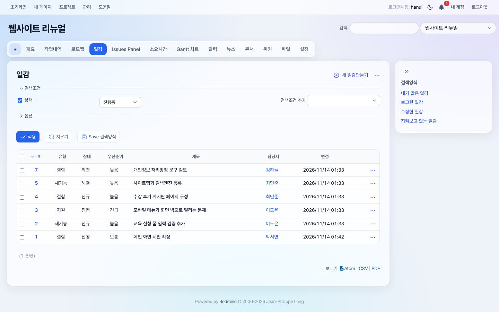
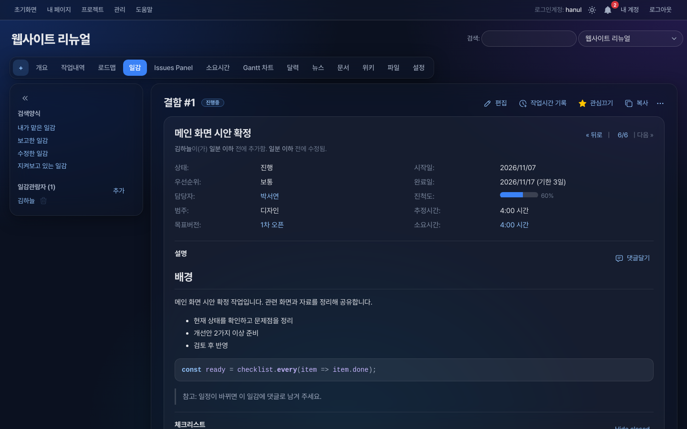
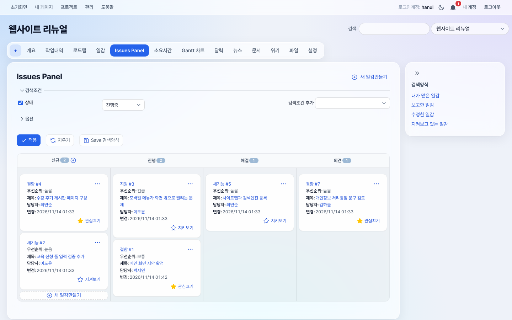
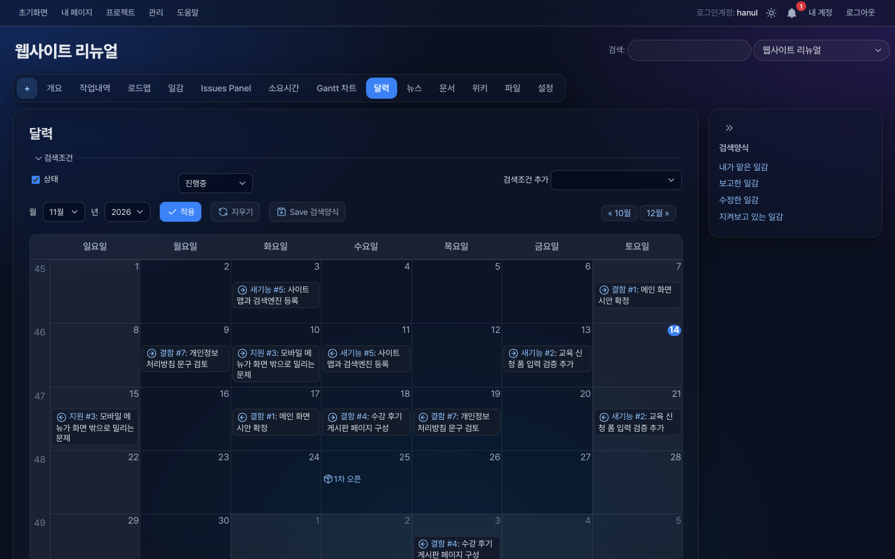
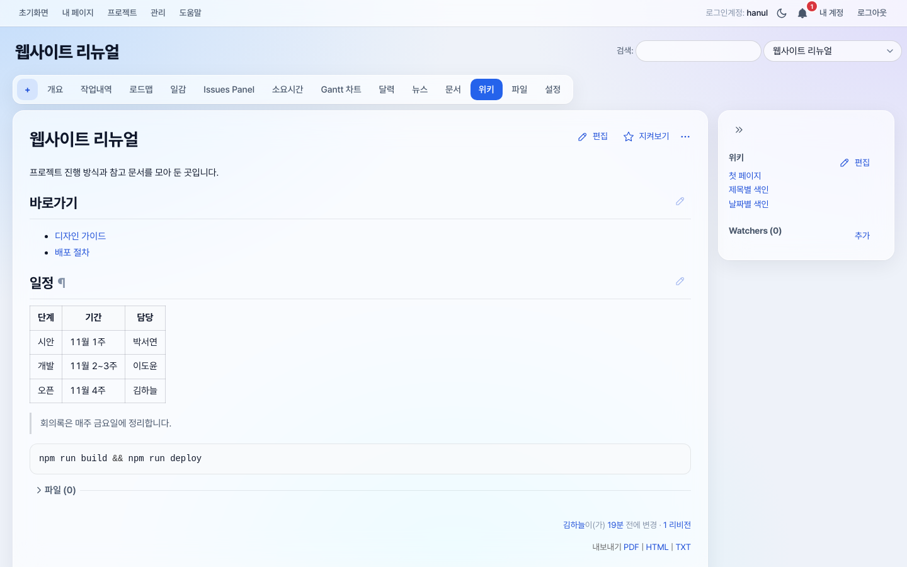
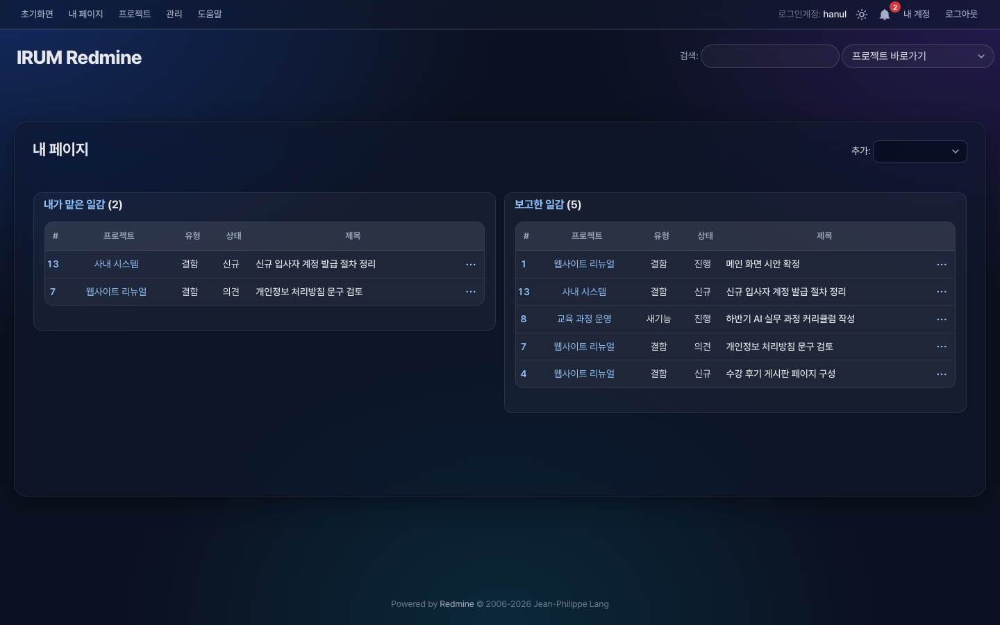
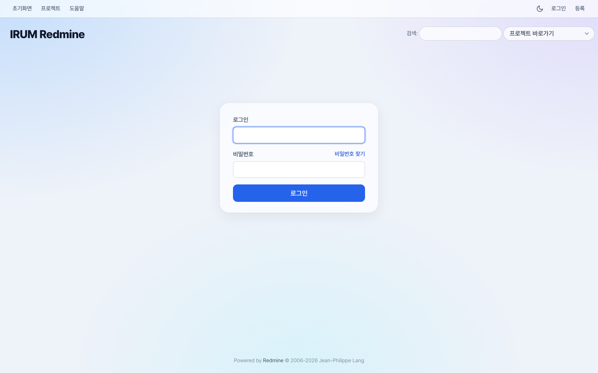
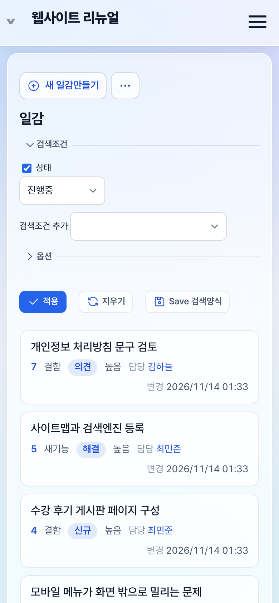
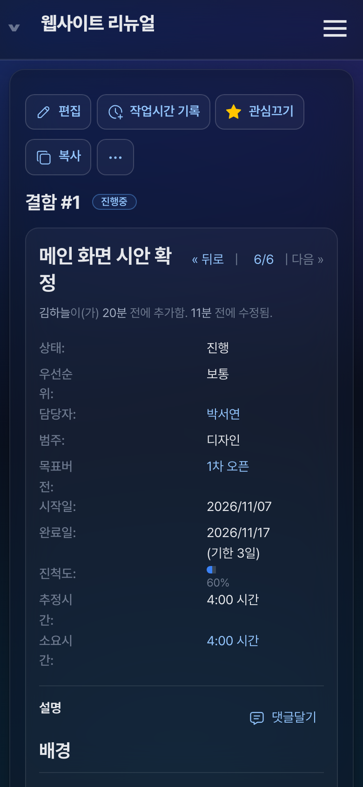
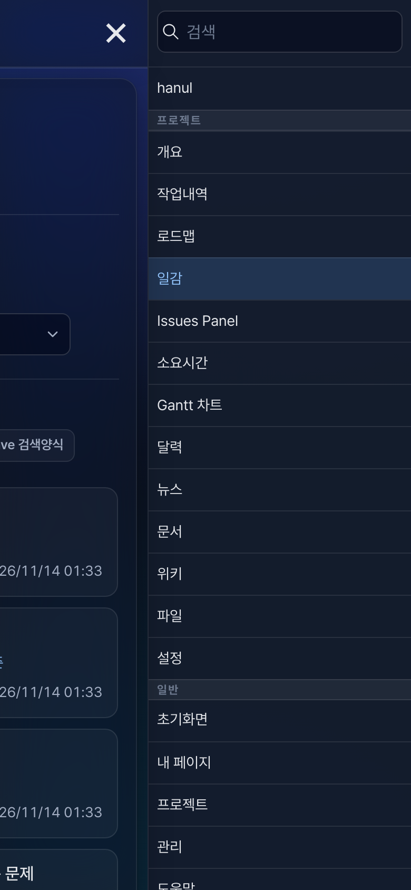

# IRUM Redmine Theme

[English](README.md) | **한국어**

[Redmine](https://www.redmine.org/) 6용 테마입니다.
은은한 그라데이션 바탕 위에 반투명 유리 패널을 놓고, 포인트 색은 차분한 블루 하나만 씁니다.
밝은 화면과 어두운 화면을 모두 지원하고, 휴대폰에서도 쓰기 편하게 다듬었습니다.
메일 테마 [SOGo Soft Glass](https://github.com/IrumAcademy/SOGo-Mail-Theme)와 같은 디자인입니다.

## 스크린샷

**일감 목록 — 라이트 모드**



| **일감 보기 — 다크 모드** | **칸반(Issues Panel)** |
|---|---|
|  |  |
| **달력 — 다크 모드** | **위키** |
|  |  |
| **내 페이지 — 다크 모드** | **로그인** |
|  |  |
| **휴대폰 — 일감 목록, 일감 보기, 메뉴** | |
|    | |

스크린샷의 프로젝트, 이름, 일감은 모두 가상의 내용입니다.

## 특징

- **유리 패널.** 본문과 왼쪽 사이드바, 상단 메뉴는 흐림 효과(`backdrop-filter`)가 들어간 반투명 카드입니다.
- **포인트 색 하나.** 선택된 메뉴, 주 버튼, 탭, 진행 막대, 링크를 블루(`#2563EB`) 하나로 통일했습니다.
- **라이트와 다크.** 처음에는 운영체제 설정을 따르고, 오른쪽 위의 해/달 버튼으로 바꿀 수 있습니다. 선택은 브라우저에 저장됩니다.
- **휴대폰.** 일감 목록은 카드로 바뀌고, 입력창은 크게 표시합니다. 입력창 글자는 16px이라 iPhone에서 화면이 확대되지 않습니다.
- **플러그인.** Issues Panel(칸반), Checklists(redmineup), 웹 알림 벨의 색을 테마에 맞췄습니다.
- **접근성과 호환.** 투명 효과 줄이기(`prefers-reduced-transparency`)를 켠 사용자와 흐림 효과를 지원하지 않는 브라우저에서는 불투명 패널을 씁니다. 인쇄하면 흰 바탕으로 나옵니다.
- **가벼움.** 외부 글꼴이나 이미지를 불러오지 않습니다. 스타일시트 하나와 해/달 버튼을 넣는 짧은 스크립트 하나가 전부입니다.

## 설치

Redmine 폴더에서 `themes/irum_redmine_theme` 라는 이름으로 내려받습니다.

```bash
cd /path/to/redmine
git clone https://github.com/IrumAcademy/IRUM-Redmine-Theme.git themes/irum_redmine_theme
```

1. Redmine을 재시작합니다. Redmine 6과 7은 시작할 때 테마 파일을 다시 빌드합니다.
2. **관리 → 설정 → 표시방식 → 테마**에서 **Irum redmine theme**을 고르고 저장합니다.
   Redmine은 폴더 이름으로 테마 이름을 표시합니다.

업데이트는 `git -C themes/irum_redmine_theme pull`을 실행한 뒤 Redmine을 재시작하면 됩니다.

### Docker (공식 `redmine` 이미지)

테마 폴더를 컨테이너에 마운트합니다.

```yaml
services:
  redmine:
    image: redmine:6.0
    volumes:
      - ./themes/irum_redmine_theme:/usr/src/redmine/themes/irum_redmine_theme:ro
```

`docker compose up -d`로 컨테이너를 다시 만든 뒤 위와 같이 테마를 고릅니다.
테마 파일을 고친 뒤에는 `docker compose restart redmine`으로 재시작해야 적용됩니다.

## 포인트 색 바꾸기

`stylesheets/application.css` 위쪽의 토큰 두 묶음에서 바꿉니다. `:root`는 라이트, `html.irum-dark`는 다크입니다.

| 토큰 | 용도 |
|---|---|
| `--ig-accent`, `--ig-accent-hover` | 선택된 메뉴, 주 버튼, 진행 막대 |
| `--ig-accent-text` | 링크와 아이콘 |
| `--ig-accent-soft`, `--ig-accent-softer`, `--ig-accent-ring` | 선택 배경, 행 hover, 입력창 포커스 테두리 |

배경 그라데이션은 `--ig-bg-grad`, 유리 투명도는 `--ig-glass`, 흐림 정도는 `--ig-blur`로 조절합니다.

## 호환

- Redmine 6.0.11과 7.0.3에서 다음 화면을 확인했습니다: 일감 목록·보기·새로 만들기, 칸반, 달력, Gantt, 로드맵, 위키, 프로젝트, 내 페이지, 관리 설정, 로그인. 데스크톱과 휴대폰(390px), 라이트와 다크 모드에서 모두 봤습니다.
- 최신 Chrome, Edge, Safari, Firefox. `backdrop-filter`가 없는 브라우저는 불투명 패널을 씁니다.
- 휴대폰 일감 카드의 "담당", "변경" 머리말은 한국어 화면에서만 붙습니다.
- 다른 플러그인 화면에서는 기본 색이 남는 곳이 있을 수 있습니다. 발견하면 이슈로 알려 주세요.

## AI 도우미로 설치하기

아래 프롬프트를 복사해서, Redmine 서버에서 명령을 실행할 수 있는 AI 코딩 도우미(Claude Code, Codex 등)에 붙여 넣으세요.

```text
이 서버의 Redmine 에 "IRUM Redmine Theme" 를 설치해 줘.

저장소: https://github.com/IrumAcademy/IRUM-Redmine-Theme

순서:
1. Redmine 이 어떻게 설치돼 있는지 찾아. 직접 설치(Redmine 폴더 안에 themes/ 가 있음)인지,
   Docker(공식 redmine 이미지, docker-compose.yml)인지 확인하고, 모르겠으면 나에게 물어봐.
   Redmine 버전이 6 또는 7 인지도 확인해.
2. 저장소를 themes/irum_redmine_theme 라는 이름으로 clone 해. Docker 라면 compose 파일 옆에 clone 하고,
   redmine 서비스에 ./themes/irum_redmine_theme:/usr/src/redmine/themes/irum_redmine_theme:ro 마운트를 추가해.
   compose 파일을 고치기 전에 백업을 만들어.
3. stylesheets/application.css 와 javascripts/theme.js 를 읽어서 외부 네트워크 요청이 없는지 확인해.
4. Redmine 을 재시작해 (Docker 면 docker compose up -d <redmine 서비스>). 다른 서비스는 건드리지 마.
5. 로그 화면에 에셋 오류가 없는지 보고, 로그인 페이지를 받아서
   themes/irum_redmine_theme/application-*.css 링크가 생겼는지 확인해 (테마를 고르기 전에는 안 보일 수 있어).
6. 관리 → 설정 → 표시방식 → 테마 에서 "Irum redmine theme" 을 고르라고 안내하고,
   되돌리는 방법(테마를 원래 값으로 바꾸고, 마운트와 폴더를 지우는 것)을 알려 줘.
```

## 라이선스

[MIT](LICENSE) © 2026 IrumAcademy
