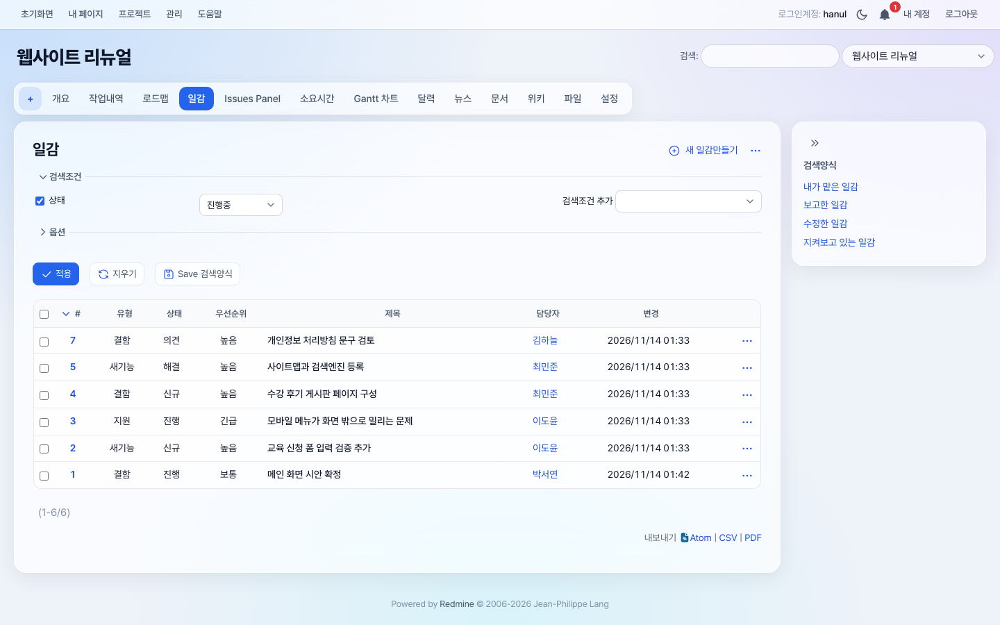
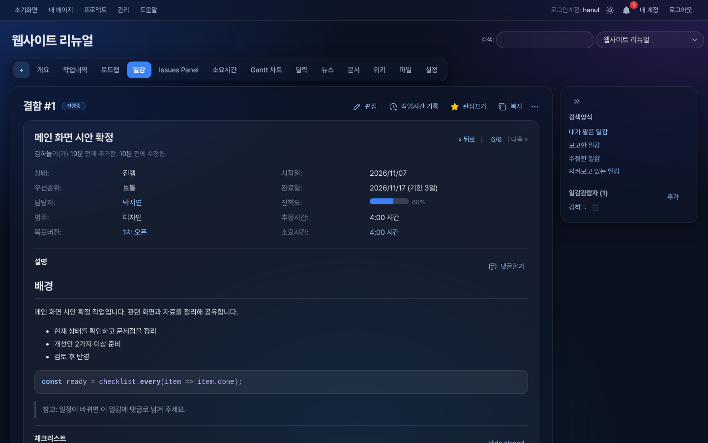
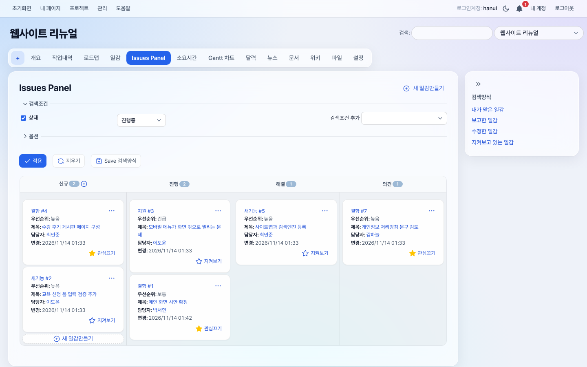
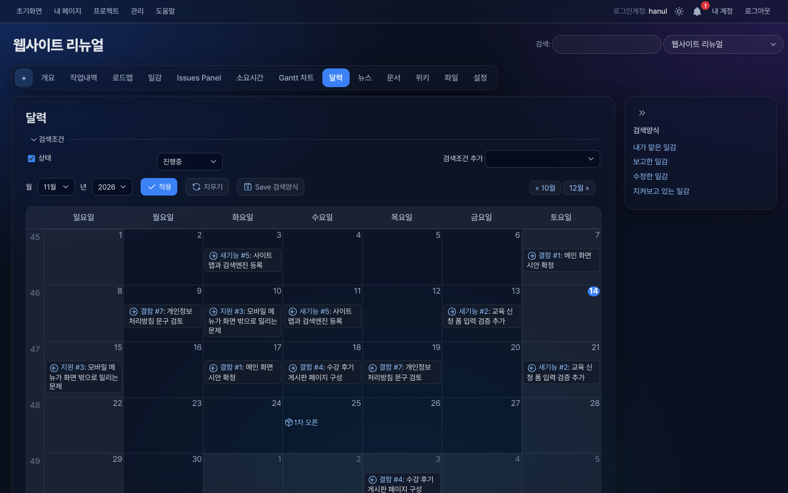
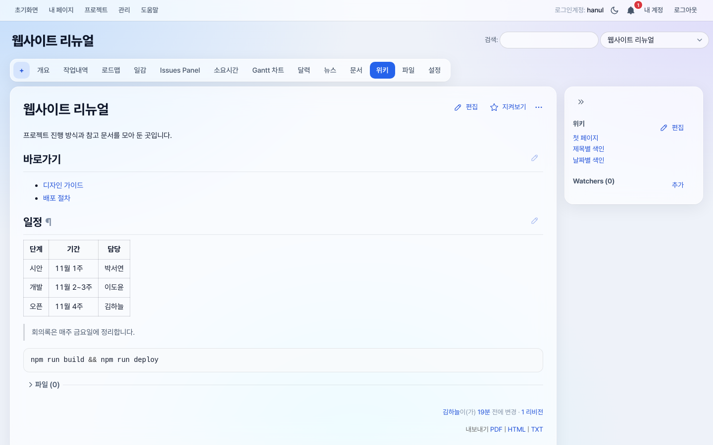
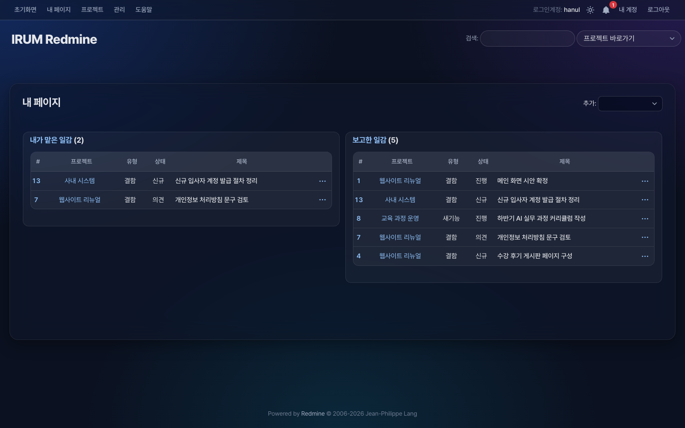
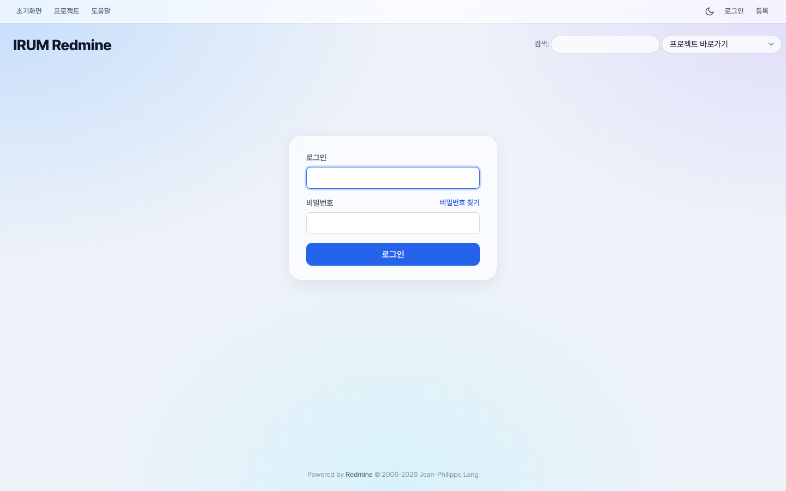
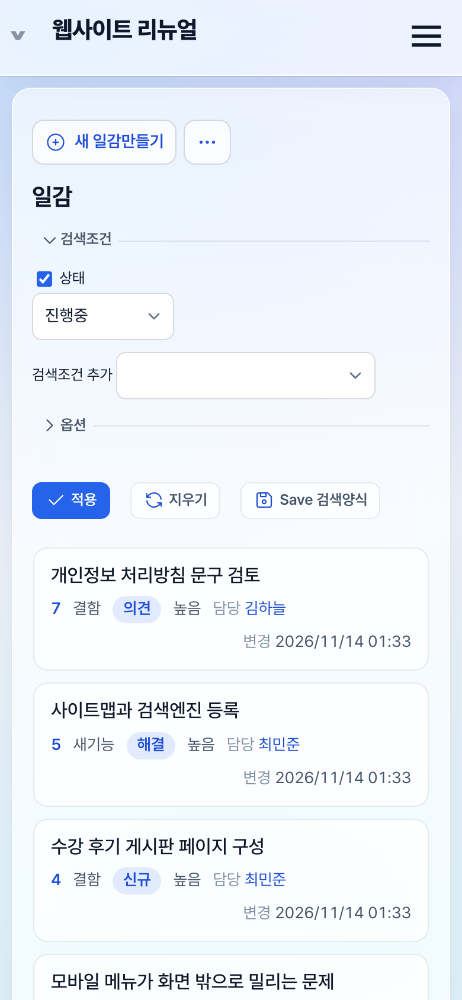
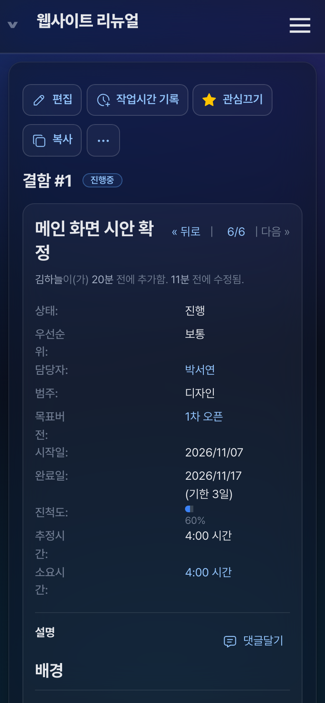
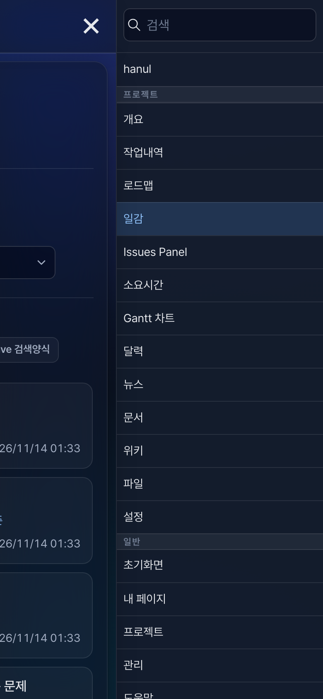

# IRUM Redmine Theme

**English** | [한국어](README.ko.md)

A theme for [Redmine](https://www.redmine.org/) 6.
Translucent glass panels sit over a subtle gradient, and a single calm blue is used as the accent.
It has light and dark modes and a tidied-up phone layout.
It matches the [SOGo Soft Glass](https://github.com/IrumAcademy/SOGo-Mail-Theme) webmail theme.

## Screenshots

**Issue list — light mode**



| **Issue — dark mode** | **Kanban (Issues Panel)** |
|---|---|
|  |  |
| **Calendar — dark mode** | **Wiki** |
|  |  |
| **My page — dark mode** | **Sign in** |
|  |  |
| **Phone — issue list, issue, menu** | |
|    | |

The screenshots use a Korean interface. The projects, names and issues in them are fictional.

## Features

- **Glass panels.** The content area, the sidebar and the top menu are translucent cards with a `backdrop-filter` blur.
- **One accent color.** The selected menu item, primary buttons, tabs, progress bars and links all use one blue (`#2563EB`).
- **Light and dark.** The theme follows the operating system at first. The sun/moon button at the top right switches it, and the choice is saved in the browser.
- **Phones.** The issue list turns into cards and form fields get bigger. Inputs use 16px text, so iPhones don't zoom in on them.
- **Plugins.** Issues Panel (kanban), Checklists (redmineup) and the web notifications bell follow the theme colors.
- **Accessibility and fallbacks.** Users with reduced transparency turned on (`prefers-reduced-transparency`), and browsers without blur support, get opaque panels. Printed pages come out on a white background.
- **Lightweight.** No external fonts or images. It is one stylesheet and one short script that adds the sun/moon button.

## Install

From your Redmine directory, clone the theme as `themes/irum_redmine_theme`:

```bash
cd /path/to/redmine
git clone https://github.com/IrumAcademy/IRUM-Redmine-Theme.git themes/irum_redmine_theme
```

1. Restart Redmine. Redmine 6 rebuilds theme assets at startup.
2. In **Administration → Settings → Display → Theme**, pick **Irum redmine theme** and save.
   Redmine names themes after their folder.

To update, run `git -C themes/irum_redmine_theme pull` and restart Redmine.

### Docker (official `redmine` image)

Mount the theme folder into the container:

```yaml
services:
  redmine:
    image: redmine:6.0
    volumes:
      - ./themes/irum_redmine_theme:/usr/src/redmine/themes/irum_redmine_theme:ro
```

Recreate the container with `docker compose up -d`, then pick the theme as above.
After you change theme files, restart with `docker compose restart redmine` to apply them.

## Changing the accent color

Edit the two token blocks at the top of `stylesheets/application.css`. `:root` is light mode and `html.irum-dark` is dark mode.

| Token | Used for |
|---|---|
| `--ig-accent`, `--ig-accent-hover` | Selected menu item, primary buttons, progress bars |
| `--ig-accent-text` | Links and icons |
| `--ig-accent-soft`, `--ig-accent-softer`, `--ig-accent-ring` | Selection backgrounds, row hover, input focus ring |

`--ig-bg-grad` sets the background gradient, `--ig-glass` the glass opacity and `--ig-blur` the blur strength.

## Compatibility

- Checked on Redmine 6.0.11: issue list, issue view and new issue, kanban, calendar, Gantt, roadmap, wiki, projects, My page, admin settings and sign-in. Each was checked on desktop and phone (390px) in light and dark mode.
- Current Chrome, Edge, Safari and Firefox. Browsers without `backdrop-filter` get opaque panels.
- On phones, the "assignee" and "updated" labels on issue cards only appear in the Korean interface.
- Pages from other plugins may still show some default colors. Please open an issue if you find one.

## Installing with an AI assistant

Copy the prompt below into an AI coding assistant (Claude Code, Codex and so on) that can run commands on your Redmine server.

```text
Install the "IRUM Redmine Theme" on this server's Redmine.

Repository: https://github.com/IrumAcademy/IRUM-Redmine-Theme

Steps:
1. Find out how Redmine is installed: directly (a Redmine folder with a themes/ directory) or with Docker
   (the official redmine image and a docker-compose.yml). If unsure, ask me. Check that it is Redmine 6.
2. Clone the repository as themes/irum_redmine_theme. For Docker, clone it next to the compose file and add the mount
   ./themes/irum_redmine_theme:/usr/src/redmine/themes/irum_redmine_theme:ro to the redmine service.
   Back up the compose file before you edit it.
3. Read stylesheets/application.css and javascripts/theme.js and check that they make no external network requests.
4. Restart Redmine (for Docker: docker compose up -d <redmine service>). Leave other services alone.
5. Check the logs for asset errors.
6. Tell me to pick "Irum redmine theme" in Administration → Settings → Display → Theme, and how to undo it
   (set the theme back, then remove the mount and the folder).
```

## License

[MIT](LICENSE) © 2026 IrumAcademy
